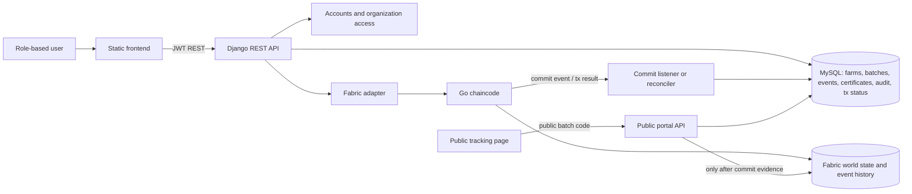
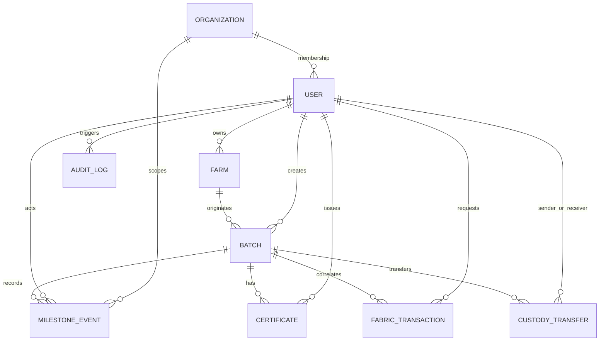
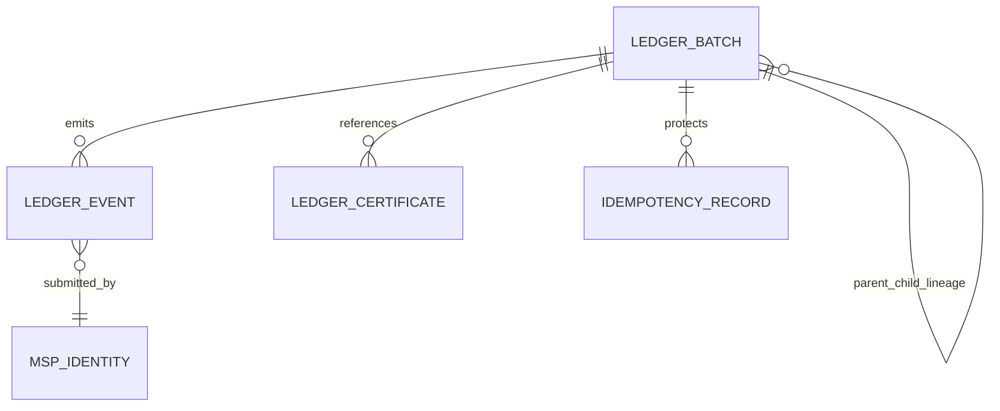
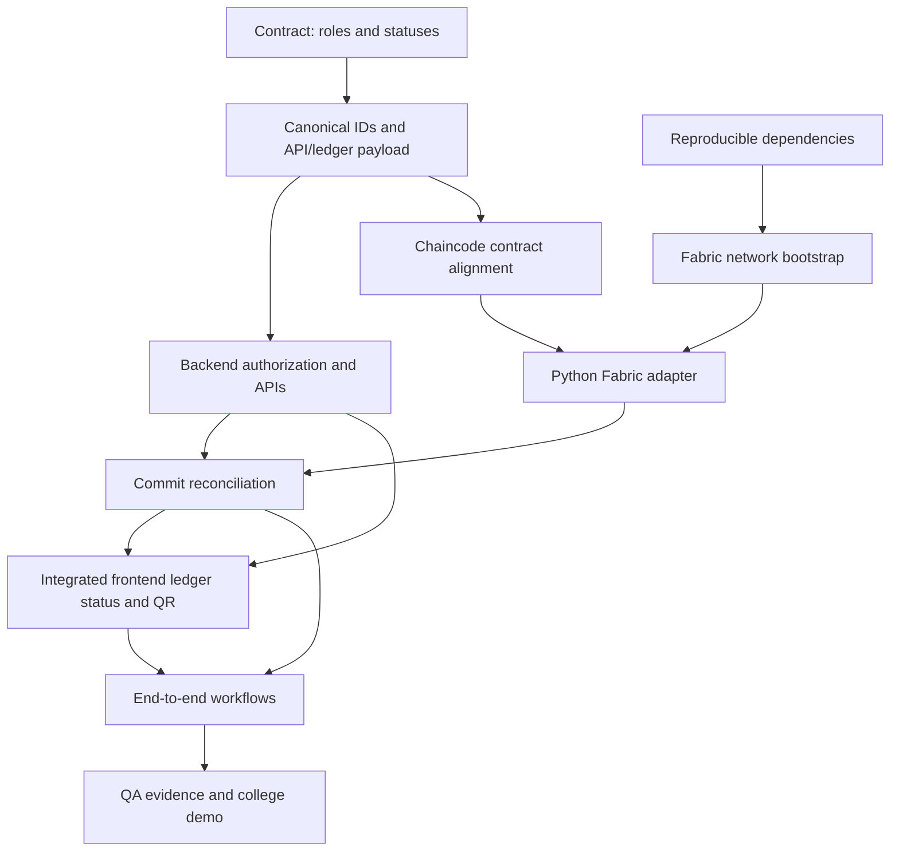

# CropChain Project Audit and Implementation Gap Analysis

**Audit scope:** repository state at `17763c8` (`System Architecture`), compared with the three reference documents in `docx/` and the current implementation. This is an evidence-based audit. No application source code was changed.

## 1. Executive summary

CropChain has substantial foundations: a static frontend, Django REST backend, relational models and migrations, and Fabric Go chaincode. The chaincode unit suite passes. The three layers do not yet form a working end-to-end product. The frontend creates database records, but does not submit batches or milestones to Fabric. The Python Fabric adapter is a deliberate placeholder when enabled, and its service payloads/method names do not match the Go contract. Several backend list/detail APIs also lack usable serializers.

**V1 readiness: Not ready.** The most serious release blockers are cross-user data access, broken traceability/quality/audit API views, absent DB-to-ledger integration, and public verification that equates selected database statuses with ledger verification. A reproducible full stack could not be established from the available environment.

### Priority summary

| Priority | Work | Reason |
|---|---|---|
| P0 | Scope farm, batch, transaction and quality reads by owner/organization; fix serializers and audit logging | Data confidentiality and core API correctness |
| P0 | Define canonical batch identity and implement Fabric adapter, submit/query/commit correlation | Integrity and truthful traceability |
| P0 | Make public verification depend on verifiable committed ledger evidence | Avoid false integrity claims |
| P1 | Complete milestone, custody, certificate workflows and responsive role-specific screens | V1 workflow completeness |
| P2 | Reproducible Fabric bootstrap, channel/lifecycle scripts, integration tests, production configuration | Operability and release confidence |
| P3 | IoT, DRL/MARL, payment automation, EPCIS/GS1 enhancements | Research/future scope, not basic V1 |

## 2. Frontend implementation

### Present

- Static HTML/CSS/JavaScript pages: landing, login, dashboard and public tracking.
- API helper targets `http://127.0.0.1:8000/api/v1` by default; demo mode is opt-in through `window.CROPCHAIN_DEMO_MODE`.
- Login stores access token and user in `sessionStorage`; dynamic display values are escaped in the reviewed code.
- Dashboard supports farm and batch creation and lists records. Public tracking queries by batch code and renders returned public events.

### Gaps and risks

- There is one generic dashboard, not workflows for collection center, warehouse, processor, inspector, retailer or administrator roles. No custody/milestone workflow, certificate issuance, batch detail/history page, search/filter controls, or QR generation is present.
- Login does not retain/use the configured refresh token; logout only clears browser storage. There is no signup UI.
- Forms create backend DB records only. No transaction submission, ledger status refresh, milestone write, or committed-event correlation is called by the frontend.
- Landing page’s demo batch code is hardcoded and no matching seed was found. Backend-generated IDs use a different format, so live public tracking can fail for that sample.
- Dashboard labels `CONFIRMED` or `SOLD` batches “Confirmed on Ledger.” `SOLD` does not prove a Fabric commit; backend status choices do not include `CONFIRMED`.
- Stage display uses `status_label` because the batch serializer does not expose current stage.
- No frontend test/package setup was found. CSS has a focus-visible treatment and a responsive media query, but this was not browser-tested.
- `frontend/.env` is not read by this static frontend; live configuration comes from a window global. Tokens in session storage raise the impact of any script injection.

### Suggested frontend ownership

One frontend engineer should implement role-aware workflows against a stable API contract, including loading/error/empty states, expiry handling, batch detail/history and QR links. Ledger state must be shown as pending/committed/failed using backend-confirmed state, never inferred from business status.

## 3. Backend implementation

### Present

Django apps cover accounts, farms, batches, traceability, quality, blockchain, public portal and audit. MySQL/SQLite settings, migrations, JWT authentication, role strings, farm/batch serializers, status transitions and write-time ownership checks exist. Registration supports operational role values; admin role creation is blocked. Batch creation validates farm ownership/inactive state and basic dates/quantity. Draft deletion is constrained.

### Critical correctness/security gaps

1. **Farm and batch read IDOR:** farm and batch list querysets return all records unless the optional `?mine=true` filter is requested. Authenticated users can retrieve arbitrary farm/batch details. Farm responses include exact latitude/longitude.
2. **Blockchain IDOR:** transaction submit, detail/query and history routes require authentication but do not scope objects by owner or organization.
3. **Quality authorization:** the batch-owner permission’s `has_permission` checks authentication only; the quality views fetch parent batches without a corresponding ownership object check. The certificate permission’s declared issuer object allowance is unreachable for non-admins because its `has_permission` denies them.
4. **Traceability API is unusable:** `BatchEventListCreate` has no serializer class; the custom `MilestoneEventSerializer` is not a DRF serializer, and the response passes its `.data` method rather than calling it. The queryset selects nonexistent `related_certificate` and `related_handoff` fields. Creating an event writes the DB and audit row but never submits it to Fabric.
5. **Quality API is unusable/incomplete:** certificate list/create lacks a DRF serializer. There is no functioning upload endpoint/serializer flow. The un-routed file response decodes bytes as UTF-8 JSON, unsuitable for arbitrary binary files. Verification hashes a stored path that the API cannot create.
6. **Audit API errors:** list/by-request views lack serializers; search refers to `models.Q` without importing `django.db.models`. Request ID lookup may match multiple rows despite using a single-object retrieve view.
7. **Audit can break writes:** `AuditLogManager.log()` constructs GeoIP2 outside its exception handler and no GeoIP database configuration was found. A failed lookup can interrupt an operation after its primary row has committed.
8. **Public verification is misleading:** public track marks selected business statuses as verified without checking for a Fabric commit. Public response otherwise avoids coordinates and actor email, which is a useful privacy boundary.

### Data-model gaps

- `User.organization` is a string; there is no organization entity or membership/provisioning model.
- `MilestoneEvent.organization` is an integer, not a foreign key.
- No `CustodyTransfer` model/stateful offer-accept-reject workflow was found.
- DB lineage is absent; lineage functionality exists only in chaincode.
- Batch tokens use a seconds-resolution timestamp as a unique value and are not used by the public URL flow; collision is possible.
- `backend/.env` is not loaded: settings load the repository-root `.env`. Settings default to a source-level secret, `DEBUG=True`, and local hosts, so production configuration needs an explicit safe profile.

### Backend ownership

Backend lead should close queryset/object authorization first, then establish actual DRF serializers and API schemas for events, certificates, audit and transactions. Add organization membership, custody state and explicit DB/ledger status fields as part of the agreed contract.

## 4. Blockchain and integration audit

### Chaincode capabilities

Go chaincode implements batch creation/verification, accept/reject, pack, transfer, store, process, inspection, certificate issue, retail/sale, batch/event/history/lineage queries and related lookups. It validates state transitions, quantity rules, emits events, and hashes certificate data. The Go test package exercises creation/sequence, MSP/role rejection, collection verification/packing, quantity conservation, idempotency and deterministic certificate hashing.

### Python-to-chaincode contract is mismatched

- `get_adapter()` defaults to a disabled adapter; an enabled configuration raises “No Fabric adapter implementation is installed.”
- Python submits `createBatch` with snake_case values as separate arguments, including a Django-generated batch ID. Go `CreateBatch` expects one JSON `CreateBatchInput` argument with camelCase properties and creates its own `RAW-...` ID.
- Python `submit_milestone_event()` constructs `recordEvent`, then delegates to batch creation instead of submitting an event.
- Python history requests `queryHistory`; Go exposes `GetBatchEvents`.
- Transaction detail reads only the DB row. No listener/poller was found to reconcile submitted transactions with ledger commit events.
- Failed transaction paths can insert blank transaction IDs into a unique field, risking repeat-failure collisions. Error handling can also create duplicate failure rows.
- No canonical mapping exists between Django batch IDs and chaincode IDs, Django identities/organizations and MSP identities, or DB business status and ledger confirmation.
- `requireBatchOwnership` is defined but no call sites were found. Some chaincode methods therefore rely on role/MSP checks without enforcing current custodian ownership.
- Idempotency records use wall-clock `time.Now()` in ledger writes, which can diverge across endorsing peers. Some state-write errors are discarded. Rich query JSON is assembled with string formatting rather than JSON encoding.

### API capability mapping

| Capability | Current chaincode | Integrated API today | Work needed |
|---|---|---|---|
| Create batch | `CreateBatch` | No | Adapter, common ID/mapping and commit reconciliation |
| Read batch | `GetBatch` | DB only | Authorized ledger query and comparison |
| Record milestone | Specialized functions/events | DB only | Explicit event contract and ledger submission |
| Custody transfer | Direct `TransferBatch` | No | Offer/accept/reject semantics and ownership checks |
| Certificate | `IssueCertificate` | Incomplete DB API | Upload/hash/reference workflow and ledger correlation |
| Batch history | `GetBatchEvents` | DB only; wrong Python method name | Correct query and event correlation |
| Verify record | No general verifier | Status-derived boolean | Verify committed transaction/event evidence |

### Network readiness

Fabric configuration and three Compose files exist, along with eight connection profiles and crypto/config templates. The repository does not include generated crypto material, channel artifacts, bootstrap/channel join/chaincode lifecycle scripts, or a network operations guide. Root Compose excludes Fabric. Profiles reference crypto files that are not present and disable TLS certificate verification. CA/CouchDB Compose files use weak hardcoded defaults (values intentionally omitted here). Config describes one etcdraft consenter, not a highly available ordering service. The network is **configuration-only; runnable ledger integration was not demonstrated**.

## 5. Interlinked architecture and data relationships

This diagram shows the intended V1 flow and the missing boundary. A user action should create a DB transaction intent, submit a canonical request to Fabric, then reconcile the committed event back into the DB before the public portal calls it verified.

**Current implementation:** the frontend/API/DB path is partly present; the adapter, commit reconciliation, safe verification decision and several API serializers are missing or broken. The dashed conceptual step in the description above must be implemented before the portal can assert ledger verification.

### ER diagram: application database

**Gap annotation:** the repository currently has `User`, `Farm`, `Batch`, `MilestoneEvent`, `Certificate`, `FabricTransaction`, and `AuditLog` concepts, but no `Organization` or `CustodyTransfer` entities. Some associations shown as intended relationships are currently strings or plain integer fields rather than foreign keys. DB lineage also needs explicit modeling or a documented decision to treat the ledger as its sole source.

### ER diagram: ledger domain

The ledger-side concepts are implemented in chaincode; these entities are conceptual world-state records, not relational tables. Django must retain stable ledger keys and transaction IDs to correlate records and expose only confirmed state as verified.

## 6. Security, configuration and quality evidence

- Enforce owner/organization scoping on every list, detail, transaction, event and certificate read; validate parent ownership on every write. Add cross-tenant negative tests.
- Replace development defaults for secret/debug/hosts with fail-closed deployment settings. Provide environment samples with placeholders and keep real secrets out of the repo.
- Use TLS-verified Fabric profiles and provision credentials through deployment secrets. Remove weak Compose defaults before any shared environment.
- Make audit failure policy explicit and avoid an unconfigured GeoIP database blocking business writes.
- Public payloads should remain allow-listed and privacy-safe. Verification must derive from committed ledger evidence and return pending/unavailable when evidence is absent.
- Root Compose config parses (`docker compose config -q`), but this proves syntax only, not startup or service health.
- `go test ./...` passed: chaincode package tests ran successfully; two packages have no test files. This is unit-level evidence only.
- `python manage.py check`, `makemigrations --check --dry-run`, and `test` could not start because Django is not installed (`ModuleNotFoundError: No module named 'django'`). These are blocked, not passing.
- No frontend test suite/package manifest, live Fabric network test, or browser E2E suite was found/run. Full stack and migrations remain unverified.

## 7. Required deliverables and implementation roadmap

| Phase | Deliverable / exit criteria | Primary owner | Depends on |
|---|---|---|---|
| 0. Contract | Versioned API/ledger contract: canonical batch key, user/MSP/org mapping, status vocabulary, idempotency, event schema, public verification semantics | Architect + backend + chaincode | None |
| 1. Security/data | Organization/membership model; scoped reads/writes; migration plan; custody transfer model; audit behavior; cross-tenant tests | Backend/security | Phase 0 |
| 2. Backend APIs | Working DRF serializers and CRUD/query semantics for batches, milestones, certificates, audit and transactions; OpenAPI/schema; robust error responses | Backend | Phases 0–1 |
| 3. Fabric runtime | Adapter, JSON argument contract, identity provisioning, TLS, network bootstrap/channel/lifecycle scripts, explicit endorsement policy | Chaincode/platform | Phase 0 |
| 4. Reconciliation | Submit intent, tx ID capture, commit listener/poller, retry/idempotency, DB status reconciliation, public verification evidence | Backend + chaincode | Phases 2–3 |
| 5. Frontend | Role-specific task flows, detail/history, custody/certificate forms, QR URL, refresh/logout, errors and responsive accessibility | Frontend | Phase 2 contract; Phase 4 ledger status |
| 6. System verification | Reproducible clean start, DB migrations, API/permission tests, Fabric integration tests, browser E2E and truthful tracking page | QA + all owners | Phases 1–5 |
| 7. Research scope | IoT ingest, DRL/MARL, payment automation, EPCIS/GS1 extension only after V1 stability | Research/product | V1 accepted |

### Suggested four-person work split

1. **Backend/security lead:** organization model, authorization, serializers, audit resilience, migration and API contract.
2. **Chaincode/platform lead:** adapter/argument contract, chaincode ownership/determinism fixes, runnable Fabric bootstrap and TLS/credential hygiene.
3. **Frontend lead:** role workflows, batch detail/history, transaction states, QR, session handling and responsive/accessibility fixes against the API contract.
4. **QA/integration lead:** dependency-pinned environment, clean-start guide, API and cross-tenant tests, Fabric commit/retry tests, frontend E2E and release evidence.

## 8. V1 definition-of-done checklist

- [ ] A documented clean checkout starts frontend, backend, relational DB and Fabric with deterministic setup steps.
- [ ] Farm/batch reads and writes enforce owner and organization boundaries; cross-tenant tests prove denial.
- [ ] Every displayed batch ID maps unambiguously between DB, Fabric state and public URL.
- [ ] Batch creation and each supported milestone have captured Fabric transaction IDs and confirmed commit status.
- [ ] A failed/unavailable ledger operation remains visibly pending/failed and cannot be called verified.
- [ ] Public tracking shows only approved fields and derives verification from ledger evidence.
- [ ] Event history, custody, certificate upload/hash and role-specific actions work end to end for the agreed V1 roles.
- [ ] Migration checks, backend tests, chaincode tests, Fabric integration and browser workflow tests pass in CI.
- [ ] Production configuration fails closed on missing secrets and verifies Fabric TLS; no default shared credentials remain.

## 9. Documentation and scope alignment

The Developer Blueprint is the best V1 authority: authentication/RBAC, batch IDs/creation, milestones, QR passport, committed/queryable Fabric event integrity, audit/status history; certificates, inventory/handoffs and responsive dashboards follow as P1. IoT, DRL/MARL, payment automation and EPCIS/GS1 are future/research scope. The Phase 1 report and paper discuss broader simulation/research results; those are not evidence that these capabilities operate in this application. Existing README/implementation-status claims should be reconciled with the code and this contract before release.

## 10. Audit limitations

This audit inspected repository code/configuration and the supplied reference documents at the audited checkout. It did not launch application services, migrate a live database, provision Fabric identities, submit a live ledger transaction, or run browser journeys. Django checks were blocked by missing installed dependencies. Findings should be revalidated after the dependency environment and runtime are available.

## 11. Feature-status matrix with evidence

**Status meanings:** COMPLETE means implemented and verified working; PARTIALLY COMPLETE means some implementation exists but the feature is incomplete; BROKEN means present but its current path is nonfunctional or materially incorrect; MISSING means no implementation was found; UNVERIFIED means runtime behavior could not be confirmed. “Verified” below refers only to the stated static inspection or test, not production readiness.

### Frontend

| Feature | Status | Evidence and problem | Correction | Priority |
|---|---|---|---|---|
| Login and token storage | PARTIALLY COMPLETE | `frontend/assets/js/login.js`, `api.js`; access token stored, refresh token not used; no signup UI | Complete refresh/expiry/logout behavior and present registration flow if required by demo | High |
| Farmer dashboard and farm/batch forms | PARTIALLY COMPLETE | `frontend/pages/dashboard.html`, `assets/js/dashboard.js`; DB-backed forms exist; no ledger submission | Connect forms to stable API and display actual async transaction state | Critical |
| Role-specific supply-chain workflows | MISSING | One generic dashboard; no participant milestone/custody/inspection screens | Implement agreed roles and allowed actions | High |
| Batch history/details | MISSING | `track.js` handles public events; no authenticated batch detail/history workflow | Add history/detail view backed by authorized event API | High |
| Ledger status indicator | BROKEN | `dashboard.js` derives “Confirmed on Ledger” from `CONFIRMED` or `SOLD` business status | Render only API-reconciled ledger commit status | Critical |
| QR generation | MISSING | No QR creation path found; landing sample is hardcoded in `index.html` | Generate a QR URL for each public batch passport | High |
| Consumer tracking | PARTIALLY COMPLETE | `pages/track.html`, `assets/js/track.js`; lookup/render path exists; ID/sample mismatch and backend verification semantics are unsafe | Use generated public URL, allow-listed data and evidence-backed verification | Critical |
| Frontend automated/E2E tests | MISSING | No frontend package/test suite identified | Add smoke/E2E coverage for login, workflow and public scan | Medium |

### Backend and database

| Feature | Status | Evidence and problem | Correction | Priority |
|---|---|---|---|---|
| Authentication and operational account verification | PARTIALLY COMPLETE | `accounts/serializers.py`, `accounts/permissions.py`; registration/JWT and unverified business-account gate exist; organization onboarding is only a string field | Define organization membership/provisioning and verify role matrix | High |
| Farm CRUD read isolation | BROKEN | `farms/views.py` `FarmListCreateView` and `FarmDetailView`; all-authenticated read path can expose other farms and exact coordinates | Scope querysets and object access by role/organization; add denial tests | Critical |
| Batch create/write validations | PARTIALLY COMPLETE | `batches/serializers.py`, `batches/views.py`; useful validation/write checks exist; generated ID is not mapped to Fabric | Preserve validation and implement stable shared key/ledger mapping | Critical |
| Batch read isolation | BROKEN | `batches/views.py` `BatchListCreateView`/`BatchDetailView`; list scoping is optional and detail GET accepts any authenticated user | Enforce scope unconditionally, including nested and public boundaries | Critical |
| Milestone event API | BROKEN | `traceability/views.py` `BatchEventListCreate`, custom serializer around line 113; missing DRF serializer, invalid queryset fields, method object in response; no Fabric write | Implement DRF serializer, valid query and authenticated create/ledger flow | Critical |
| Certificate/quality API | BROKEN | `quality/views.py` `BatchCertificateListCreate`, custom serializer; no functional upload path and issuer permission is blocked | Implement validated upload/hash serializer, role/owner permissions and storage response | High |
| Audit API/logging | BROKEN | `audit/views.py` list and request-ID views have no serializer; search uses missing `models` import; GeoIP setup can break writes | Add serializers, correct query imports/lookup cardinality and make enrichment resilient | High |
| Relational organization/custody model | MISSING | `accounts/models.py`, `traceability/models.py`; organization is text and event organization is integer, no custody-transfer model | Add normalized organization membership and transfer entities/migrations | High |
| DB migrations and Django suite | UNVERIFIED | Migrations/tests exist; `manage.py` commands blocked because Django dependency missing | Install declared backend requirements in supported environment; run migrations/checks/full tests | High |

### Blockchain and integration

| Feature | Status | Evidence and problem | Correction | Priority |
|---|---|---|---|---|
| Go chaincode state transitions and unit suite | PARTIALLY COMPLETE | `chaincode/` implementation and `go test ./...` passed; no live peer/orderer test and ownership/determinism concerns remain | Harden identity/current-custodian checks; preserve passing unit behavior; add peer integration tests | High |
| Local Fabric deployment | UNVERIFIED | Fabric Compose/config/profile files exist; generated crypto/channel artifacts and bootstrap/lifecycle scripts are absent; network was not launched | Provide reproducible network bootstrap and health-check instructions | High |
| Python Fabric adapter | BROKEN | `backend/apps/blockchain/adapter.py` `get_adapter()` rejects enabled mode without implementation | Implement adapter backed by supported Fabric Gateway client/runtime | Critical |
| Batch create contract | BROKEN | `blockchain/service.py` calls `createBatch` with separate snake_case values; chaincode `CreateBatch` expects one JSON argument and generates its own ID | Version and share canonical request/response schema and ID mapping | Critical |
| Milestone ledger submission | BROKEN | `submit_milestone_event()` delegates to batch creation | Submit supported event/function with the documented JSON schema | Critical |
| History query | BROKEN | `batch_history()` calls `queryHistory`; chaincode exposes `GetBatchEvents` | Correct function/argument/response mapping and tests | High |
| Commit status/transaction correlation | MISSING | `TransactionDetailView` reads DB; no listener/reconciler found | Capture tx ID, await/query commit and persist confirmed/invalid/unknown state idempotently | Critical |
| Public ledger verification | BROKEN | `public_portal/views.py` computes `verified` from business status choices | Verify actual committed state/event evidence and fail closed | Critical |
| QR/public token | PARTIALLY COMPLETE | Public endpoint/token model exists; token is not used in URL flow and generation has collision concern | Use a secure stable public identifier and create/scan QR link | High |

## 12. Dependency-aware implementation plan

The estimates are relative effort for one experienced contributor; they are not calendar commitments. Role names describe ownership and can be mapped to the actual team. “Parallel” means work can proceed independently after listed prerequisites; all branches must integrate through the shared API/ledger contract.

### Phase 0 — Contract and environment

| ID | Task / workstream | Priority | Dependencies | Output and acceptance criteria | Complexity |
|---|---|---|---|---|---|
| C0-1 | Freeze V1 roles, status vocabulary, public fields and allowed milestones / Integration architecture | Critical | None | Reviewed API/ledger contract names actors, permitted transitions, public allow-list, and verified/pending/failed semantics | Medium |
| C0-2 | Define canonical batch ID, DB↔Fabric mapping, JSON payloads, idempotency key and commit response / Backend + Blockchain | Critical | C0-1 | Shared versioned examples; create and event requests round-trip without ID or field ambiguity | Medium |
| C0-3 | Prepare reproducible dependency environment / QA | High | None | Documented install command makes Django checks runnable; Go and Docker prerequisites/version recorded; no secret values committed | Small |

**Parallel:** C0-1 and C0-3. C0-2 follows C0-1. Backend, chaincode and frontend implementation should wait for C0-1/C0-2 where contract-dependent.

**Phase exit:** contract accepted by role owners; baseline environment commands and dependency limitations recorded.

### Phase 1 — Backend corrections and essential APIs

| ID | Task / workstream | Priority | Dependencies | Output and acceptance criteria | Complexity |
|---|---|---|---|---|---|
| B1-1 | Scope farm/batch/transaction/event/certificate querysets and object writes / Backend security | Critical | C0-1 | Two-user tests prove users cannot list, retrieve, update or delete another tenant’s private records; admin rules explicit | Large |
| B1-2 | Add Organization and membership relationships; migration/backfill strategy / Backend data | High | C0-1 | Migrations apply to clean DB and documented existing DB; role authorization uses membership IDs | Large |
| B1-3 | Repair milestone serializer/list/create/history API / Backend | Critical | C0-2, B1-1 | Valid DRF schema, create/list/detail responses serialize; invalid transitions and foreign batches rejected | Medium |
| B1-4 | Repair certificate upload/hash/issuer verification flow / Backend quality | High | B1-1, C0-1 | Authorized issuer uploads an allowed file; hash is reproducible; unauthorized user cannot access it; binary download remains intact | Medium |
| B1-5 | Repair audit list/search/request lookup and resilient logging / Backend | High | B1-1 | List/search endpoints serialize; duplicate request IDs behave deterministically; missing GeoIP does not break business writes | Small |
| B1-6 | Add explicit transaction intent/status and batch ledger mapping fields / Backend data | Critical | C0-2, B1-2 | Unique DB batch key maps to ledger key; tx state supports pending/committed/invalid/failed without blank unique tx IDs | Medium |
| B1-7 | Fix settings for documented local demo and fail-closed deployment config / Backend/platform | High | C0-3 | Clean local setup works; production mode refuses missing secrets and unsafe debug/host defaults | Small |

**Parallel:** B1-2, B1-3, B1-4, B1-5 and B1-7 can proceed after contract decisions; B1-1 should be reviewed before merging their endpoints. B1-6 follows C0-2 and data model decisions. DB migrations require coordinated ownership.

**Phase exit:** Django checks, migration consistency and backend tests pass; tenant isolation tests pass; API schema matches C0 contract; no unresolved serializer/runtime errors on required endpoints.

### Phase 2 — Fabric network and chaincode integration

| ID | Task / workstream | Priority | Dependencies | Output and acceptance criteria | Complexity |
|---|---|---|---|---|---|
| F2-1 | Make local Fabric network reproducible: crypto, channel, join, lifecycle and health scripts / Blockchain platform | High | C0-3 | Fresh environment follows guide to healthy peer/orderer/channel; scripts are repeatable and secrets are not weak defaults | Large |
| F2-2 | Implement and configure Python Fabric adapter / Blockchain integration | Critical | C0-2, F2-1 | Django submits/query through real Gateway; TLS identity verified; adapter errors are explicit and covered | Large |
| F2-3 | Align chaincode create/event/history functions and JSON schema / Chaincode | Critical | C0-2 | Contract tests prove create ID mapping, milestone records, history result, authorization and idempotency | Large |
| F2-4 | Enforce owner/current-custodian checks and deterministic ledger writes / Chaincode security | Critical | C0-1, F2-3 | Unauthorized identities are rejected; endorsing peers produce matching results; state-write errors are surfaced | Medium |
| F2-5 | Capture transaction IDs and reconcile commit status into DB / Integration | Critical | B1-6, F2-2, F2-3 | Commit event updates matching intent once; retries do not duplicate records; invalid/unavailable transactions never show verified | Large |

**Parallel:** F2-1 and F2-3 can proceed in parallel against C0-2. F2-2 needs the runtime and contract. F2-4 aligns with F2-3. F2-5 waits for Phase 1 transaction fields and working adapter/chaincode.

**Phase exit:** from a clean local Fabric network, an API batch create produces a real tx ID and committed ledger state; a milestone can be queried in history; a failed or invalid commit remains non-verified.

### Phase 3 — Frontend completion

| ID | Task / workstream | Priority | Dependencies | Output and acceptance criteria | Complexity |
|---|---|---|---|---|---|
| U3-1 | Complete access/refresh expiry, logout and signup/login feedback / Frontend | High | C0-1, backend auth contract | Expired access recovers or signs out cleanly; logout clears server/browser session as supported; errors are actionable | Medium |
| U3-2 | Role-aware dashboard, farm and batch management / Frontend | High | B1-1, B1-3, API schema | Each agreed role sees only allowed actions and own authorized records; create flow uses canonical ID | Large |
| U3-3 | Milestone, inspection and custody forms / Frontend | High | B1-3, B1-4, F2-5 status contract | Valid actions submit once, errors remain visible, success distinguishes submitted from committed | Large |
| U3-4 | Batch details and ledger-backed history/transaction status / Frontend | High | B1-3, F2-5 | UI renders ordered history and explicit pending/committed/invalid state from API evidence | Medium |
| U3-5 | QR generation and public consumer tracking / Frontend | High | C0-1, public API contract, B1-6, F2-5 | QR decodes to the correct public batch URL; page has no private data and truthful verification | Medium |

**Parallel:** U3-1 and visual shell work can proceed once contract is stable; U3-2/3/4 depend on backend schemas. U3-5 can implement UI scaffolding in parallel, but verification display requires F2-5.

**Phase exit:** all agreed role journeys render and submit against API; session expiry and unauthorized responses are handled; QR reaches correct public page and UI never infers ledger commitment from business status.

### Phase 4 — End-to-end integration

| ID | Task / workstream | Priority | Dependencies | Output and acceptance criteria | Complexity |
|---|---|---|---|---|---|
| I4-1 | Integrate farmer batch creation through DB, Fabric commit and generated passport / Integration | Critical | Phases 1–3 | One scripted/browser journey yields matching DB/ledger/public identifiers and captured commit evidence | Large |
| I4-2 | Integrate role-based milestone sequence and history / Integration | Critical | I4-1, U3-3, U3-4 | Authorized users record milestones; UI/API/ledger history agree and unauthorized attempts fail | Large |
| I4-3 | Verify QR/public privacy and outage/invalid-commit behavior / Security integration | Critical | U3-5, F2-5 | Valid, pending, failed, unknown and private batch cases produce correct safe outcomes | Medium |
| I4-4 | Reconcile retries, duplicate submissions, restart and DB/ledger drift / Reliability | High | F2-5 | Repeated request is idempotent; restart can reconcile pending tx; discrepancies are visible and not called verified | Large |

**Parallel:** I4-2 and I4-3 can begin after I4-1 contract is stable. I4-4 can be developed alongside but final acceptance needs integrated environment.

**Phase exit:** all system journeys pass against running database and Fabric services; recorded DB, chaincode and UI states agree for success and failure scenarios.

### Phase 5 — QA and college submission preparation

| ID | Task / workstream | Priority | Dependencies | Output and acceptance criteria | Complexity |
|---|---|---|---|---|---|
| Q5-1 | Backend API, authorization and migration suite / QA | Critical | Phases 1, 4 | CI runs clean DB migration and tests, including tenant boundaries and failure paths | Medium |
| Q5-2 | Chaincode/Fabric integration suite / QA | Critical | Phases 2, 4 | Tests exercise real peer commit/query, invalid endorsement/identity and repeat request | Large |
| Q5-3 | Browser E2E, QR scan and responsive check / QA | High | Phases 3–4 | Main demo path passes from login through consumer scan at documented viewport sizes | Medium |
| Q5-4 | Clean-start guide, architecture and demo script / Integration documentation | High | Q5-1 through Q5-3 | New checkout can follow documented steps; demo states prerequisites, expected screens, transaction evidence and reset procedure | Medium |
| Q5-5 | Release review against V1 checklist / All workstream owners | Critical | Q5-1 through Q5-4 | Every checklist item has a linked test/evidence or is explicitly deferred; no false capability claims remain | Small |

**Phase exit:** reproducible setup and end-to-end demo are demonstrated; required checks pass; known limitations and evidence are documented for college submission.

## 13. Work allocation and dependency map

| Workstream role | Owns | Coordinates with |
|---|---|---|
| Backend/data/security owner | B1-1 through B1-7; API schemas; migrations; tenant boundary | Blockchain for IDs/status; frontend for schemas; QA for negative tests |
| Fabric/chaincode owner | F2-1 through F2-4; network, identity, contracts, TLS | Backend for adapter/mapping; integration for commit behavior |
| Frontend owner | U3-1 through U3-5; role flows and public tracking | Backend for stable endpoints; QA for browser scenarios |
| Integration/QA/documentation owner | C0-3, F2-5, I4-1 through I4-4, Q5-1 through Q5-5 | All owners; maintains acceptance evidence and clean-start guide |

**Approval gate:** this document completes Stage 1 and Stage 2 requested in the pasted plan. Stage 3 source implementation has not started. Approval can identify a phase or task IDs to begin; the recommended first implementation slice is Phase 1 backend/security after C0-1/C0-2 are accepted.
