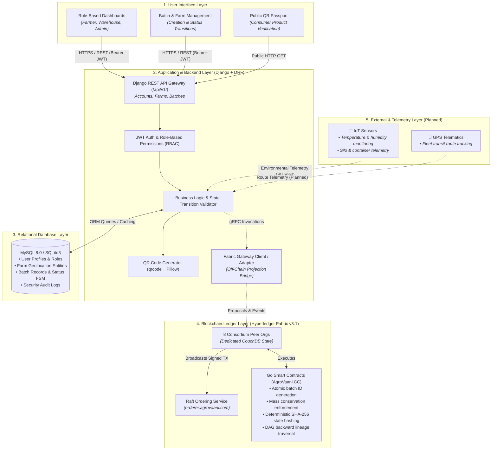

# CropChain: Agriculture & Food Supply Chain Traceability

<div align="center">

[]()
[]()
[]()
[]()
[]()
[]()
[]()

**A digital, farm-to-fork supply chain traceability platform connecting agricultural producers, processors, certifiers, retailers, and consumers through verifiable records and transparent product journeys.**

[Key Features](#-key-features) • [Supply Chain Workflow](#-interconnected-supply-chain-workflow) • [Technical Architecture](#-technical-architecture) • [Getting Started](#-getting-started) • [Development Status](#-development-status) • [Meet the Team](#-meet-the-team)

</div>

---

## 📌 Project Overview

**CropChain** is a digital agricultural supply-chain management and traceability platform. Modern food systems involve multiple independent intermediaries—farmers, collection centers, logistics transporters, warehouses, food processors, quality inspectors, and retailers. In traditional setups, recordkeeping is siloed, paper-based, or centralized, leading to:

- **Information Asymmetry**: Downstream buyers and consumers cannot verify crop origins or farming practices.
- **Untracked Custody Transfers**: Products frequently suffer loss, adulteration, or delays during transit without clear accountability.
- **Vulnerable Certifications**: Standalone paper certificates or digital files can be forged or reassigned to uninspected batches.
- **Inaccessible Product History**: Consumers have no friction-free way to inspect the true journey of their food.

### The CropChain Solution

CropChain provides an integrated platform that anchors produce at the farm, tracks custody handoffs across every stage, binds quality inspections cryptographically to batch states, and enables consumers to scan a QR code to view an authentic product passport.

> [!NOTE]
> **Enterprise Focus**: CropChain is designed strictly for enterprise supply-chain accountability and data integrity. It is **not** a cryptocurrency or token-trading platform.

---

## 🌾 Value for Stakeholders

| Stakeholder | Key Benefit |
|---|---|
| **Farmers & Growers** | Digitally prove produce origin, protect brand value, and gain fair recognition for sustainable practices. |
| **Supply Chain Businesses** | Standardize batch handoffs, eliminate paperwork friction, minimize disputes, and streamline recall management. |
| **Inspectors & Labs** | Cryptographically bind lab inspection data to batch states, preventing certificate tampering. |
| **Consumers** | Scan packaging QR codes to view verified farm origin, processing milestones, and safety credentials. |

---

## 🔄 Interconnected Supply Chain Workflow

The diagram below illustrates how a product batch travels through the supply chain and how each participant contributes vital information to its verifiable digital history.

```mermaid
flowchart TD
    subgraph S1["1. Origin"]
        Farmer["👨‍🌾 Farmer / Grower<br/><b>Crop & Harvest Details</b><br/>• Farm plot GPS coordinates<br/>• Crop name & botanical variety<br/>• Harvest & planting dates<br/>• Initial batch quantity"]
    end

    subgraph S2["2. Aggregation & Sorting"]
        CC["🏢 Collection Centre<br/><b>Intake & Sorting</b><br/>• Moisture & quality grading<br/>• Batch acceptance / rejection<br/>• Standardized packaging (CC Batch)"]
    end

    subgraph S3["3. Logistics"]
        Transporter["🚚 Transporter<br/><b>Transit & Custody</b><br/>• Custody transfer verification<br/>• Vehicle registration number<br/>• Route & transit milestones"]
    end

    subgraph S4["4. Holding"]
        Warehouse["🏬 Warehouse<br/><b>Storage & Inventory</b><br/>• Storage zone & bay assignment<br/>• Inbound condition checks<br/>• Inventory holding (WH Batch)"]
    end

    subgraph S5["5. Processing"]
        Manufacturer["🏭 Processor / Manufacturer<br/><b>Processing & Transformation</b><br/>• Multi-batch aggregation<br/>• Mass conservation accounting<br/>• Finished packaged goods (MFG Batch)"]
    end

    subgraph S6["6. Assurance"]
        Inspector["🔬 Quality Inspector / Lab<br/><b>Inspection & Certification</b><br/>• Lab compliance analysis<br/>• Deterministic batch state hashing<br/>• Tamper-proof certificate issuance"]
    end

    subgraph S7["7. Retail"]
        Retailer["🛒 Retailer / Supermarket<br/><b>Listing & Sales</b><br/>• Retail SKU assignment<br/>• Shelf stocking & store listing<br/>• Point-of-sale checkout (RET Batch)"]
    end

    subgraph S8["8. Verification"]
        Consumer["📱 End Consumer<br/><b>Public Product Passport</b><br/>• QR code package scan<br/>• Complete timeline visualization<br/>• Verified origin & safety audit"]
    end

    Farmer -->|"Dispatches raw harvest (RAW-Batch)"| CC
    CC -->|"Transfers inspected crates"| Transporter
    Transporter -->|"Delivers to facility"| Warehouse
    Warehouse -->|"Transfers raw produce"| Manufacturer
    Manufacturer -->|"Submits batch for testing"| Inspector
    Inspector -->|"Approves certified batch"| Retailer
    Retailer -->|"Sells verified package"| Consumer
```



---

## 🏛️ Technical Architecture

CropChain separates client interfaces, transactional application services, relational storage, and permissioned distributed ledgers into distinct architectural layers.



> **Legend**:
> - `───►` Solid line: **Implemented and fully functional** (Django REST API, MySQL DB, Chaincode logic, Frontend pages).
> - `┄┄─►` Dashed line: **Planned / Integration in progress** (Direct automated Fabric Gateway bridge, IoT sensors, GPS telematics).

---

## ⚡ Key Features

| Category | Feature | Description | Status |
|---|---|---|---|
| **Access Control** | **Multi-Role RBAC** | 8 distinct supply chain roles with tailored permissions (`farmer`, `warehouse`, `inspector`, etc.). | **Implemented** |
| **Farm Management** | **Plot & Geolocation Tracking** | Registered farm plots with GPS coordinates, acreage, address hierarchy, and verification status. | **Implemented** |
| **Batch Tracking** | **Crop Batch FSM** | Lifecycle state transitions (`DRAFT` &rarr; `HARVESTED` &rarr; `IN_TRANSIT` &rarr; `PROCESSING` &rarr; `PACKED` &rarr; `SOLD`). | **Implemented** |
| **Consumer Portal** | **QR Product Passport** | Publicly accessible web page rendering chronological batch provenance from farm to store. | **Implemented** |
| **Smart Contracts** | **Deterministic State Hashing** | Cryptographically binds quality inspection certificates to canonical SHA-256 batch state hashes. | **Implemented** |
| **Lineage Engine** | **DAG Provenance Traversal** | Directed Acyclic Graph tracking parent-child relationships across batch splits and aggregations. | **Implemented** |
| **Audit & Security** | **Immutable Audit Logs** | Comprehensive action and actor logging with IP address capture and metadata tracking. | **In Progress** |
| **Telemetry** | **IoT & GPS Monitoring** | Real-time temperature, humidity, and location tracking for transit containers and silos. | **Planned** |

---

## 🛠️ Technology Stack

| Layer | Technology | Purpose in CropChain |
|---|---|---|
| **Frontend** | HTML5, CSS3, Vanilla ES6 JavaScript | Clean, responsive UI with role dashboards and public QR tracking portal. |
| **Backend** | Python 3.11+, Django 5.2, Django REST Framework | Central API gateway, business logic, JWT authentication, and input validation. |
| **Database** | MySQL 8.0 (Production) / SQLite3 (Development) | High-performance relational storage for users, farms, batches, and audit logs. |
| **Blockchain** | Hyperledger Fabric v3.1 | Enterprise permissioned distributed ledger with Raft crash-fault-tolerant consensus. |
| **Smart Contracts** | Go 1.22 (`fabric-contract-api-go/v2`) | On-chain business logic, state hashing, mass conservation, and DAG lineage queries. |
| **QR Code Engine** | Python `qrcode`, `Pillow` | Dynamic generation of product passport QR codes linking to public tracking URLs. |
| **Containerization** | Docker Engine & Docker Compose | Multi-container environment for Fabric CAs, peers, CouchDB, and chaincode CCaaS. |

---

## 📂 Project Structure

```
CropChain/
├── backend/                       # Django REST API service
│   ├── apps/
│   │   ├── accounts/              # Custom User model, JWT authentication, RBAC
│   │   ├── farms/                 # Farm plot geolocation and ownership
│   │   ├── batches/               # Agricultural batch records and status state machine
│   │   ├── audit/                 # System security audit logging
│   │   ├── traceability/          # Custody transfers and supply chain events
│   │   ├── quality/               # Inspection records and laboratory certificates
│   │   ├── blockchain/            # Blockchain transaction projections
│   │   └── public_portal/         # Public consumer passport view
│   ├── config/                    # Django root settings and URL routing
│   ├── requirements.txt           # Python package dependencies
│   └── manage.py                  # Django CLI management utility
├── blockchain/                    # Hyperledger Fabric infrastructure
│   ├── chaincode/                 # Go smart contracts (AgroVaaniContract)
│   │   ├── chaincode/             # Domain logic (lineage, state hashing, batch FSM)
│   │   ├── tests/                 # Go unit tests with mock chaincode stubs
│   │   └── Dockerfile             # Multi-stage container build for Fabric CCaaS
│   └── network/                   # Fabric network topologies & connection profiles
│       ├── connection-profiles/   # Connection JSON files for 8 consortium MSPs
│       ├── docker/                # Compose definitions (CAs, CouchDB, peers, orderer)
│       ├── configtx.yaml          # Consortium channel and policy definitions
│       └── crypto-config.yaml     # Organization identity topology
├── frontend/                      # Web user interface
│   └── cropchain-frontend (1)/frontend/
│       ├── assets/                # Design tokens, CSS styles, and ES6 API modules
│       ├── pages/                 # Views (login.html, dashboard.html, track.html)
│       └── index.html             # Landing page and platform overview
└── README.md                      # Project documentation (this file)
```

---

## 🚀 Getting Started

Follow these steps to set up and run CropChain on your local machine.

### Prerequisites

- **Python**: Version `3.11` to `3.14`
- **Go**: Version `1.22+` (required for chaincode development/testing)
- **Database**: MySQL `8.0+` or SQLite3
- **Containerization**: Docker Engine & Docker Compose (for Fabric network)

---

### Step 1: Clone the Repository

```bash
git clone https://github.com/ChandanMandal20052023/CropChain.git
cd CropChain
```

---

### Step 2: Backend Setup (Django)

1. **Create and activate a virtual environment**:
   ```bash
   cd backend
   python -m venv venv

   # On Linux/macOS:
   source venv/bin/activate

   # On Windows (PowerShell):
   .\venv\Scripts\Activate.ps1
   ```

2. **Install dependencies**:
   ```bash
   pip install -r requirements.txt
   ```

3. **Configure environment variables**:
   ```bash
   cp .env.example .env
   ```
   *By default, the backend runs using SQLite3 for rapid local testing. To use MySQL, set `DB_ENGINE=mysql` and update credentials in `.env`.*

4. **Run database migrations**:
   ```bash
   python manage.py migrate
   ```

5. **Create an administrator account**:
   ```bash
   python manage.py createsuperuser
   ```

6. **Start the API development server**:
   ```bash
   python manage.py runserver 127.0.0.1:8000
   ```
   The REST API will be live at `http://127.0.0.1:8000/api/v1/`.

---

### Step 3: Frontend Execution

Serve the frontend using any static HTTP server (required for ES6 modules):

```bash
cd "frontend/cropchain-frontend (1)/frontend"
python -m http.server 8080
```

Open `http://localhost:8080` in your web browser.

> **Tip**: In `assets/js/api.js`, toggle `CONFIG.DEMO_MODE = false;` to switch from built-in mock demonstration data to the live Django backend API.

---

### Step 4: Run Tests

- **Run Django backend test suite** (56 unit tests):
  ```bash
  cd backend
  python manage.py test
  ```
- **Run Go chaincode unit tests** (mock stub tests):
  ```bash
  cd blockchain/chaincode
  go test -v ./tests
  ```

<details>
<summary><b>Detailed Fabric Network Startup (Click to expand)</b></summary>

To start the local Hyperledger Fabric test network:

```bash
cd blockchain/network
cryptogen generate --config=./crypto-config.yaml --output=./crypto-config

docker compose -f docker/docker-compose-ca.yaml up -d
docker compose -f docker/docker-compose-couchdb.yaml up -d
docker compose -f docker/docker-compose-network.yaml up -d
```
</details>

---

## 📊 Development Status

| Module | Capability | Status | Evidence |
|---|---|---|---|
| **Accounts** | Custom User model, JWT authentication, 8 role choices | **Completed** | `backend/apps/accounts/` |
| **Farms** | Farm plot registration, GPS coordinates, area validation | **Completed** | `backend/apps/farms/` |
| **Batches** | Batch creation, automated code generation, lifecycle FSM | **Completed** | `backend/apps/batches/` |
| **Chaincode** | Go smart contracts, deterministic state hashing, mass conservation | **Completed** | `blockchain/chaincode/chaincode/` |
| **Chaincode Tests** | Mock stub unit tests (authorization, packing, hashing, idempotency) | **Completed** | `blockchain/chaincode/tests/` |
| **Network Config** | Raft consensus, 8 peer MSPs, CouchDB, connection profiles | **Completed** | `blockchain/network/` |
| **Frontend UI** | Operations dashboard, login, and public QR passport view | **Completed** | `frontend/cropchain-frontend (1)/frontend/` |
| **Audit** | Security audit logging model | **In Progress** | `backend/apps/audit/models.py` |
| **Off-Chain Bridge** | Automated Django-to-Fabric Gateway background listener | **Planned** | `backend/apps/blockchain/` |
| **Quality Module** | Lab certificate upload & hash verification API | **Planned** | `backend/apps/quality/` |
| **Telemetry** | IoT sensor data ingestion (temperature, humidity, GPS) | **Planned** | Future Phase |

---

## 👥 Meet the Team

CropChain is designed and developed through the collaborative efforts of our core project team:

| Team Member | Role | Contribution Focus |
|---|---|---|
| **Chandan Kumar Mandal** | **Team Lead / Developer** | System Architecture, Blockchain Network Configuration, Go Chaincode, and Backend REST APIs |
| **Harsh** | **Team Member** | Backend API Engineering, Relational Database Modeling, and Business Logic |
| **Vaishnavi Jha** | **Team Member** | Frontend User Experience, Public Passport Portal, and Client Integration |
| **Shyamji Dwivedi** | **Team Member** | Quality Assurance, Test Suite Implementation, and Technical Documentation |

> *The CropChain team is dedicated to building transparent, accessible, and secure digital tools that empower agricultural producers and protect food integrity.*

---

## 🗺️ Roadmap

- [x] Custom User Model & JWT Role-Based Access Control
- [x] Farm Plot Management with Geolocation Precision
- [x] Crop Batch Registration & Finite State Machine
- [x] Hyperledger Fabric Go Smart Contracts & DAG Provenance Logic
- [x] Consumer QR Product Passport Web Interface
- [ ] Automated Django-to-Fabric Gateway Event Listener
- [ ] Quality Certificate Upload with SHA-256 Verification API
- [ ] Real-time IoT Container Sensor Integration (Temperature & Humidity)
- [ ] GPS Transit Route Telematics
- [ ] GS1 / EPCIS 2.0 Global Standards Alignment

---

