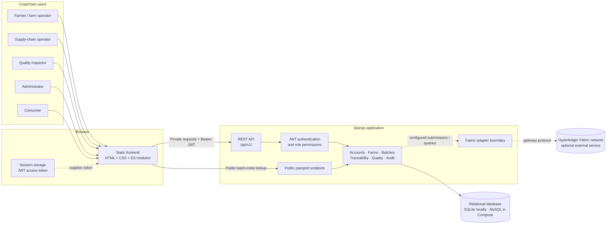
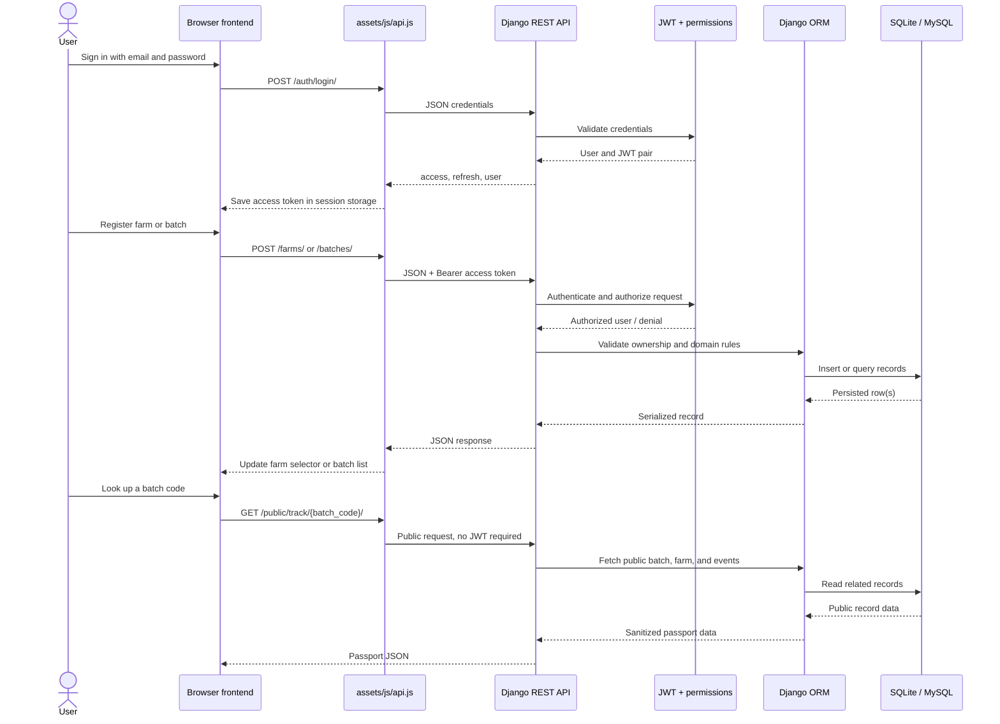
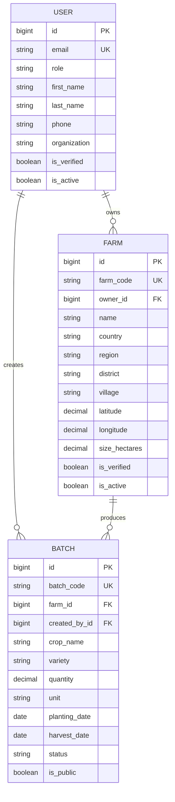
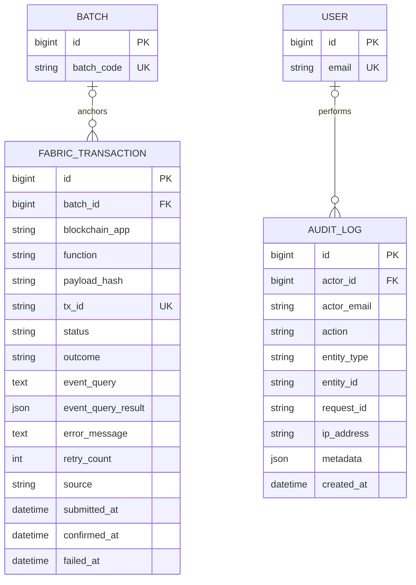
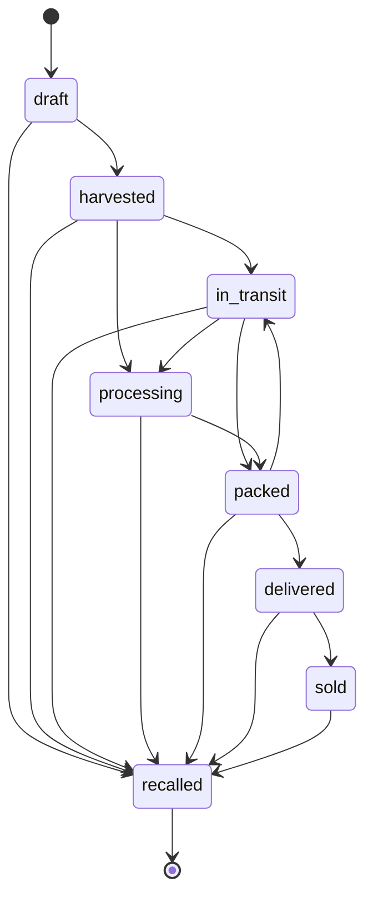
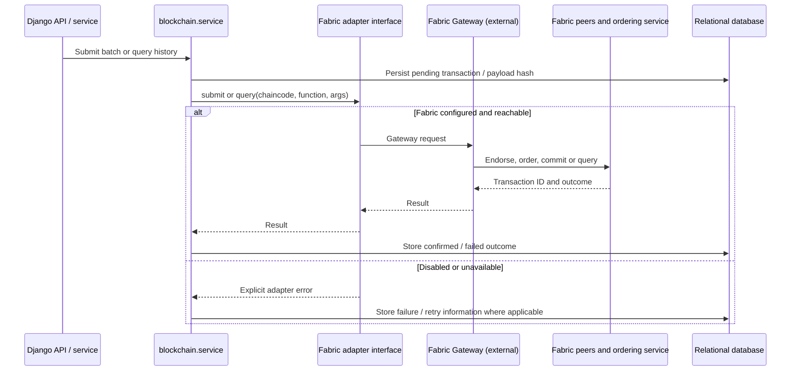
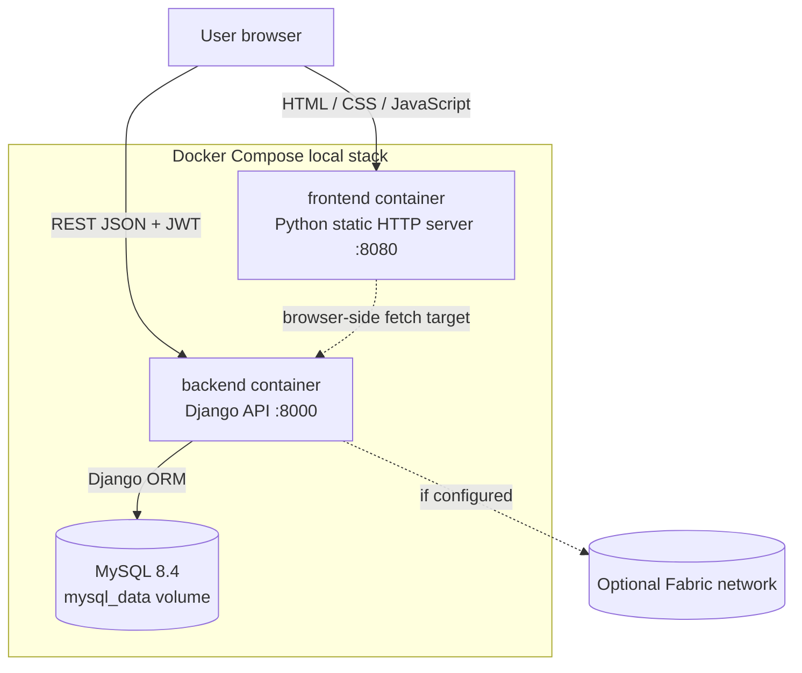

# CropChain System Architecture

This document describes the architecture represented by the current repository. The diagrams use the same component names and record keys so that the browser-to-database flow in [1](#1-system-context), the request sequence in [2](#2-request-and-data-flow), and the related entity diagrams in [4](#4-relational-data-model) can be read together.

## Contents

1. [System context](#1-system-context)
2. [Request and data flow](#2-request-and-data-flow)
3. [Backend responsibilities and API](#3-backend-responsibilities-and-api)
4. [Relational data model](#4-relational-data-model)
5. [Batch lifecycle and traceability](#5-batch-lifecycle-and-traceability)
6. [Blockchain integration boundary](#6-blockchain-integration-boundary)
7. [Deployment topology](#7-deployment-topology)
8. [Security and data exposure](#8-security-and-data-exposure)
9. [Implementation boundaries](#9-implementation-boundaries)

## 1. System context

The browser serves the static HTML, CSS, and JavaScript application. The frontend calls Django REST Framework over HTTP at `/api/v1/`. Django authenticates private operations with JWTs, applies application permissions, and stores the operational records in a relational database. Public product tracking uses a separate unauthenticated read endpoint.

The optional Hyperledger Fabric adapter is a backend integration boundary. The normal local stack does not require a Fabric network; Fabric behavior is disabled unless configured and connected.



**How the context diagram connects to the rest of this document:** the private request path is expanded in [2](#2-request-and-data-flow); the persisted records behind `Domain` are shown in [4](#4-relational-data-model); and the optional dotted Fabric path is detailed in [6](#6-blockchain-integration-boundary).

## 2. Request and data flow

Private pages use the shared frontend API client. After login, the client stores the access token in browser session storage and sends it as `Authorization: Bearer …` on authenticated requests. Django resolves the user, checks the view’s role/ownership rules, performs ORM operations, and returns JSON. A public passport lookup does not require a token and returns a sanitized view of a public batch.



The endpoint families are mounted under `/api/v1/`:

| Area | Main routes | Access pattern |
|---|---|---|
| Accounts | `auth/register/`, `auth/login/`, `auth/refresh/`, `auth/logout/`, `auth/me/`, `auth/change-password/`, `auth/roles/`, `users/` | Registration and login are public; profile and administration routes are authenticated and permission checked. |
| Farms | `farms/`, `farms/{id}/` | Authenticated reads; creation and changes require applicable role, verification, and ownership permissions. |
| Batches | `batches/`, `batches/{id}/` | Authenticated reads; writes are restricted by role, verification, and farm ownership. |
| Traceability | `batches/{batch_code}/events/` | Authenticated, verified participants with permission for the batch. |
| Quality | `batches/{batch_code}/certificates/`, `certificates/{id}/verify/` | Authenticated, verified and authorized users; uploaded certificate files are hash checked. |
| Blockchain | `transactions/`, `transactions/{tx_id}/`, `batches/{batch_code}/history/` | Authenticated API; actual ledger operations depend on a configured Fabric adapter and network. |
| Public portal | `public/track/{batch_code}/` | Public read; only records marked `is_public` are returned. |
| Audit | `audit/`, `audit/{request_id}/` | Restricted to administrator/audit permissions. |

## 3. Backend responsibilities and API

The Django project is split into domain apps. The URLs are composed in `backend/config/urls.py`; the REST framework uses JWT authentication by default and views add role, verification, and ownership checks where needed.

| App | Responsibility | Persisted data |
|---|---|---|
| `accounts` | Email-based users, roles, JWT login and user administration | `User` |
| `farms` | Farm ownership, location details, verification and activity | `Farm` |
| `batches` | Crop batch records, batch codes, quantities, dates and valid status transitions | `Batch` |
| `traceability` | Supply-chain milestone events and their ledger status | `MilestoneEvent` |
| `quality` | Certificate metadata, uploaded-file reference and SHA-256 verification status | `Certificate` |
| `blockchain` | Persisted submission, outcome, retry and query information | `FabricTransaction` |
| `public_portal` | Public exposure token associated with a batch and the passport response | `BatchToken` |
| `audit` | Actor, action, entity, request ID, IP and metadata for audit records | `AuditLog` |

## 4. Relational data model

The model diagrams below are split by domain to keep the fields legible. They are **interlinked by the same database primary and foreign keys**: `User.id` joins across diagrams, and `Batch.id` is the shared parent key for farm production, traceability, quality, public access and ledger records. The connector labels are cardinalities: `||` means exactly one, `o|` means zero or one, and `o{` means zero or many.

### 4.1 Accounts, farms and batches



`Farm.owner_id` points to `User.id`; `Batch.farm_id` points to `Farm.id`; and `Batch.created_by_id` points to `User.id`. A farm can produce many batches, while each batch references one farm and one creating user. These are the core records created and listed by the current dashboard.

### 4.2 Traceability, quality and public passport

```mermaid
erDiagram
    BATCH ||--o{ MILESTONE_EVENT : records
    USER o|--o{ MILESTONE_EVENT : acts_in
    BATCH ||--o{ CERTIFICATE : has
    USER ||--o{ CERTIFICATE : issues
    BATCH ||--o| BATCH_TOKEN : exposes

    BATCH {
        bigint id PK
        string batch_code UK
    }

    MILESTONE_EVENT {
        bigint id PK
        bigint batch_id FK
        bigint actor_id FK
        string actor_email
        bigint organization
        string event_type
        datetime occurred_at
        decimal quantity
        string unit
        text notes
        json metadata
        boolean submitted_to_blockchain
        string blockchain_tx_id
        string blockchain_status
    }

    CERTIFICATE {
        bigint id PK
        bigint batch_id FK
        bigint issued_by_id FK
        string certificate_type
        date issue_date
        string organization
        string storage_path
        string original_name
        string sha256
        string status
        json metadata
    }

    BATCH_TOKEN {
        bigint id PK
        bigint batch_id FK_UK
        string token UK
        datetime expires_at
        datetime used_at
    }

    USER {
        bigint id PK
        string email UK
    }
```

`MilestoneEvent.batch_id` and `Certificate.batch_id` both refer to the `Batch.id` shown in [4.1](#41-accounts-farms-and-batches); `actor_id` and `issued_by_id` refer to `User.id`. Each `BatchToken` is one-to-one with a batch. The public route currently looks up by batch code and checks `Batch.is_public`; the token is stored as a separate passport model.

`MilestoneEvent.organization` is a positive integer holding an actor or farm-owner ID; it is not a database foreign key. `actor_id` is the actual optional relationship to `User`.

### 4.3 Ledger transaction and audit records



`FabricTransaction.batch_id` references `Batch.id` but is nullable because a transaction may not be attached to a batch. `AuditLog.actor_id` is nullable so audit evidence can remain if a user account is removed. Traceability events also retain their own blockchain transaction ID and status; a `FabricTransaction` is the separate record for a Fabric submission lifecycle.

## 5. Batch lifecycle and traceability

Batch state is validated by the backend state machine in `Batch.STATUS_TRANSITIONS`. Event records provide dated milestones alongside the batch’s current status. The public passport presents the public batch fields, farm origin summary, and chronological events. Ledger submission state is exposed as pending, confirmed, or failed where a submission exists; advancing a batch state alone does not prove a Fabric commit.



The status state machine and event history serve different roles:

- `Batch.status` is the current lifecycle state and is constrained by allowed transitions.
- `MilestoneEvent` is an append-oriented record of an event type, actor, occurrence time, quantity, notes, and optional blockchain linkage.
- `Certificate` attaches a certificate and its server-computed file hash to the same `Batch`.
- The public passport joins a public `Batch` to its `Farm` and public event summaries; private batch descriptions, exact coordinates, and participant email addresses are not part of the public response.

## 6. Blockchain integration boundary

The Django business layer calls the adapter interface rather than importing a Fabric SDK directly. A configured adapter can submit or query chaincode operations and persist `FabricTransaction` results. The adapter in the repository defines this boundary and the disabled mode, but a production Fabric Gateway implementation still needs a reachable network, credentials, and agreed chaincode function names.



Setting a gateway URL alone does not make the ledger integration live. The application must use a concrete adapter compatible with the target Fabric network and have the chaincode/channel, identity, and network access configured.

## 7. Deployment topology

The repository supports two local arrangements. A direct development setup runs the Django server and static frontend separately, with SQLite by default. `compose.yaml` runs a MySQL service, Django API container, and Python static file server; MySQL data is stored in a named volume. Fabric is outside this Compose stack.



The browser calls the API directly, so Django CORS settings must include the frontend origin. In Compose these are `http://localhost:8080` and `http://127.0.0.1:8080`. For local Python servers on another port, add that origin to `CORS_ALLOWED_ORIGINS`.

| Configuration | Local Python processes | Docker Compose |
|---|---|---|
| Frontend | `frontend/`, static server on port `8080` | `frontend` service, port `8080` |
| Backend | `backend/manage.py runserver`, port `8000` | `backend` service, port `8000`; applies migrations at startup |
| Database | SQLite file under `backend/` by default; MySQL can be selected with `DB_ENGINE=mysql` | MySQL service and persistent `mysql_data` volume |
| Fabric | Disabled unless separately configured | Not included; external and optional |

## 8. Security and data exposure

- Private APIs use JWT authentication by default. Individual endpoints also apply role, account-verification, and record-ownership rules.
- The browser stores the access token in `sessionStorage`, which is scoped to the current browser tab session. The API client attaches it as a Bearer token to authenticated requests.
- The public passport endpoint is unauthenticated by design, but only returns a batch with `is_public=True` and a limited set of farm and event details.
- Exact latitude/longitude, private batch descriptions, and actor email addresses are excluded from the public passport response.
- Certificate file references and SHA-256 hashes belong to the quality workflow. File downloads and verification are authenticated and permission checked.
- Audit metadata is intended for operational accountability. Passwords, tokens, private keys, and raw uploaded bytes should not be placed in audit metadata.
- Values in `.env.example` and Compose are local-development defaults. Production deployments need managed secrets, HTTPS, restricted allowed hosts/origins, and an appropriately hardened application server/database.

## 9. Implementation boundaries

The diagrams describe the current code, including these limits:

- SQLite is the no-configuration Django default. MySQL is supported by settings and is used by the Compose stack.
- The HTML frontend currently covers login, the farmer dashboard, farm registration, batch registration, and public tracking. Other domain APIs exist in Django but do not all have corresponding frontend screens.
- The public tracking UI reads a batch code. The current API returns a `public_url_token`, but the route itself is addressed by `batch_code`; token-based URL resolution is not yet the lookup contract.
- The Fabric adapter is an explicit integration seam. A working production Gateway client and live Fabric network are not bundled in the local stack.
- `MilestoneEvent`, `Certificate`, `FabricTransaction`, and `AuditLog` are separate persisted records. A relationship in the ORM diagram represents a database foreign key, not automatic ledger submission or a guarantee that every operation creates an audit record.

