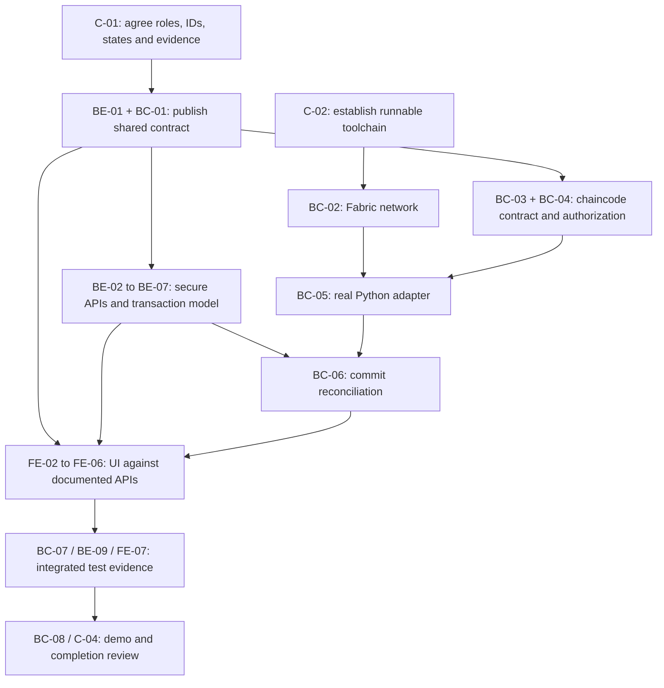

# CropChain Work Allocation and Completion Tracker

**Basis:** `PROJECT_AUDIT_REPORT.md` and the supplied CropChain Developer Blueprint. This plan assigns work to the three developer roles specified by the project team. It does not assert that assigned work is complete.

**Current recorded state:** Audit and planning are complete. Stage 3 implementation has not been approved or started. All implementation tracker items below therefore begin as **Not started**. Update status only when code and the acceptance evidence are available.

## Status rules

- **Not started:** no implementation work recorded.
- **In progress:** implementation underway; acceptance criteria are not yet met.
- **Blocked:** a named dependency or environment condition prevents progress; record the blocker.
- **Implemented, unverified:** code exists but required checks have not passed.
- **Verified:** acceptance criteria pass with recorded test/runtime evidence.
- **Deferred:** explicitly removed from the agreed V1 scope.

Do not mark an item Verified because code was written. Record test commands/results and relevant paths or commit IDs in the evidence column.

## Developer ownership

| Developer | Assigned role | Accountable areas |
|---|---|---|
| Developer 1 | Frontend Developer | Frontend audit/implementation, UI/UX, auth/session and role interfaces, forms, dashboard, batch history, QR/public tracking, API integration, frontend tests and fixes |
| Developer 2 | Backend Developer | Django/DRF, models/migrations, auth/RBAC, farm/batch/milestone/quality/audit APIs, validation/permissions, backend tests/schema, backend side of ledger contract |
| Developer 3 | Blockchain and Full-stack Integration Developer | Fabric network/identities/channel/deployment, Go chaincode, Python adapter, transaction IDs/commit proof, DB-ledger consistency, cross-module coordination and E2E execution |

## Shared contract and dependencies

Developer 2 and Developer 3 jointly own the backend-to-blockchain contract. Developer 2 owns its API/data-model side; Developer 3 owns its Fabric request, identity and commit semantics. Developer 1 integrates only against the versioned contract they publish. Developer 3 coordinates the integration gate and final end-to-end verification.

The following decisions must be written down before contract-dependent implementation:

1. Canonical batch identifier and its mapping to the Fabric key.
2. Supported roles, organizations/MSP identities and permissions for each state transition.
3. Versioned JSON payloads for batch creation and milestones, including validation/error shapes.
4. Idempotency key, transaction ID storage, and commit states (`pending`, `committed`, `invalid`/`failed`, and unavailable/unknown behavior).
5. Which ledger event/history query is authoritative and how DB records are reconciled after restart/retry.
6. Public tracking allow-list, QR URL format and exact evidence required to show ledger verification.

## Individual task list — Developer 1 (Frontend)

| ID | Task | Priority | Dependencies | Acceptance criteria | Complexity | Status | Evidence / blocker |
|---|---|---|---|---|---|---|---|
| FE-01 | Audit existing pages, API calls, role entry points and user journeys; map screens to the V1 blueprint | High | None | Screen/flow inventory identifies each existing path, missing role flow and related API endpoint | Small | Verified (audit only) | `PROJECT_AUDIT_REPORT.md` §2; no frontend implementation verified |
| FE-02 | Implement login/session lifecycle, token expiry handling, logout and registration UX as supported by API | High | API auth contract from BE-01 | Expired session is handled; logout clears server/browser auth as supported; errors are displayed; role navigation respects API role | Medium | Not started | |
| FE-03 | Implement role-aware dashboard and farm/batch management | High | API contract BE-01; authorization BE-03 | Each agreed role sees permitted actions and scoped records; farmer can create a farm/batch and gets canonical batch ID | Large | Not started | |
| FE-04 | Add batch detail, ordered milestone history and transaction status views | High | Event/history schema BE-01; commit status contract BC-02 | UI renders history from API and distinguishes submitted/pending/committed/invalid without inferring commit from business status | Medium | Not started | |
| FE-05 | Add milestone, inspection and custody forms for the agreed V1 workflow | High | Role/state contract C-01; milestone API BE-04 | Valid actions are available only to allowed roles/states; submitted events display server result and recoverable errors | Large | Not started | |
| FE-06 | Generate QR linking to the canonical public tracking URL and finish consumer page | High | Public API/URL contract C-01; BE-06 | Scanned code opens correct batch; page shows allow-listed fields and ledger verification only when API supplies commit evidence | Medium | Not started | |
| FE-07 | Add frontend workflow tests and fix responsive/accessibility issues | Medium | FE-02–FE-06 and stable APIs | Automated checks cover login, create batch, milestone/history, QR/public tracking and key viewport/accessibility behavior | Medium | Not started | |

**Frontend completion gate:** FE-02–FE-06 pass against the documented API in the integrated environment; FE-07 provides reproducible test results. The current static UI is not evidence these acceptance criteria are met.

## Individual task list — Developer 2 (Backend)

| ID | Task | Priority | Dependencies | Acceptance criteria | Complexity | Status | Evidence / blocker |
|---|---|---|---|---|---|---|---|
| BE-01 | Publish versioned REST/API and backend-to-Fabric contract with Developer 3 | Critical | C-01 roles/status decisions | OpenAPI or equivalent schemas define auth, canonical IDs, batch/event payloads, response/errors, transaction status and public verification | Medium | Not started | Joint gate with BC-01 |
| BE-02 | Fix farm, batch, transaction, event and certificate read/write tenant scoping | Critical | C-01 organization/role rules | Cross-user tests prove unauthorized list/detail/update/delete and parent-object access are denied; admin policy is explicit | Large | Not started | |
| BE-03 | Add normalized organization membership and permission relationships; plan/apply migrations | High | C-01 role/org contract | Clean DB migrates; existing data migration/backfill is documented; authorization uses relationships rather than free-form strings | Large | Not started | Coordinate migration review with BC-01 |
| BE-04 | Repair milestone create/list/detail/history API and serializer | Critical | BE-01, BE-02 | Valid DRF serializers; correct related fields; endpoints pass create/read/validation/permission tests; writes produce durable event intent | Medium | Not started | |
| BE-05 | Complete quality inspection and certificate upload/hash/verification APIs | High | BE-01, BE-02 | Authorized roles can create inspections/certificates; binary upload/download works; hash validation and access restrictions tested | Medium | Not started | |
| BE-06 | Fix audit search/list/request lookup and make audit enrichment non-blocking | High | BE-02 | APIs serialize and search correctly; duplicate request IDs are handled deterministically; no configured GeoIP DB does not break business writes | Small | Not started | |
| BE-07 | Implement transaction intent, batch↔ledger mapping, idempotent status persistence and reconciliation data model | Critical | BE-01, BC-01 | Unique canonical key and tx IDs recorded; pending/committed/invalid/failure states persist safely; retries cannot create blank-ID collisions | Large | Not started | Joint design with Developer 3 |
| BE-08 | Harden environment configuration and produce backend run/migration instructions | High | None | Local setup works from documented dependencies; deployment config fails closed for missing secrets and unsafe settings | Small | Not started | |
| BE-09 | Add backend/API schema, migration, auth and cross-tenant regression tests | Critical | BE-02–BE-07 | Supported environment runs Django checks, migration consistency and tests; evidence is recorded in CI or reproducible command output | Large | Not started | Django was absent during prior audit; environment setup required |

**Backend completion gate:** required endpoints return valid documented representations, enforce role/tenant permissions, persist consistent transaction status, and backend checks/tests pass. See `PROJECT_AUDIT_REPORT.md` §3 for current broken paths.

## Individual task list — Developer 3 (Blockchain and Full-stack Integration)

| ID | Task | Priority | Dependencies | Acceptance criteria | Complexity | Status | Evidence / blocker |
|---|---|---|---|---|---|---|---|
| BC-01 | Jointly finalize and version backend↔Fabric contract with Developer 2 | Critical | C-01 | Canonical key, JSON schemas, identity/MSP mapping, idempotency, errors, commit semantics and history query agreed in a checked-in document | Medium | Not started | Joint gate with BE-01 |
| BC-02 | Make a local Fabric network reproducible: identities, channel, peer join, chaincode lifecycle and health checks | High | BC-01 decisions; Docker/Fabric prerequisites | Clean setup reaches a healthy channel and deployed chaincode using documented repeatable commands; TLS verification enabled and no weak shared credentials | Large | Not started | |
| BC-03 | Align Go chaincode methods and payloads with the agreed create/milestone/history contract | Critical | BC-01 | Tests prove canonical ID mapping, create, allowed milestone transitions, event/history queries and idempotency | Large | Not started | Preserve existing passing Go unit tests |
| BC-04 | Enforce MSP role/current-custodian authorization and deterministic ledger writes | Critical | BC-01, BC-03 | Unauthorized identity and non-custodian tests reject; writes do not rely on wall clock; all ledger write errors surface | Medium | Not started | |
| BC-05 | Implement Python Fabric adapter and backend service integration | Critical | BC-01, BC-02, BE-07 | Real Gateway submit/query uses verified TLS/identity; adapter returns Fabric tx ID and structured result; errors do not masquerade as success | Large | Not started | |
| BC-06 | Implement transaction commit-status capture and DB↔ledger reconciliation | Critical | BE-07, BC-05 | Commit/invalid status is correlated exactly once; retries and restart reconcile safely; unavailable/unknown never means verified | Large | Not started | Joint with Developer 2 |
| BC-07 | Add Fabric integration tests and execution/demo orchestration | Critical | BC-02–BC-06, FE/BE integration | Running peer test proves API-created batch and milestones commit and are queried; clean-start/demo instructions work from a fresh checkout | Large | Not started | |
| BC-08 | Coordinate E2E verification, issue triage and final architecture/run documentation | High | All workstreams integrated | End-to-end evidence covers auth, batch, ledger, milestones, history, QR, public privacy, failure/retry; remaining issues are explicit | Medium | Not started | |

**Blockchain/integration completion gate:** actual Fabric commits and history queries are demonstrated through the application. Unit tests or mocked adapter responses alone do not meet this gate.

## Shared tasks and dependency order

| ID | Task | Owners | Priority | Dependencies | Acceptance criteria | Complexity | Status |
|---|---|---|---|---|---|---|---|
| C-01 | Agree V1 roles, states, transitions, canonical ID policy, public fields and verification semantics | Developers 1, 2, 3; Developer 3 facilitates | Critical | None | Decision record reviewed by all; no frontend/backend/Fabric state ambiguity | Medium | Not started |
| C-02 | Establish runnable dependency/toolchain baseline | Developers 2 and 3; Developer 1 records frontend prerequisites | High | None | Django/DB, Go, Docker/Fabric and frontend commands are versioned and runnable or blocker recorded | Small | Partially verified | Go unit tests and compose config parsing previously succeeded; Django unavailable; no Fabric/E2E run |
| C-03 | Integration checkpoints and shared issue/evidence log | Developer 3 coordinates; all contribute | High | C-01 | Contract changes, blockers, test evidence and cross-module defects are recorded at each phase gate | Small | Not started |
| C-04 | End-to-end demo/release checklist | All; Developer 3 accountable | Critical | BE/BC/FE completion | Every final completion criterion has a reproducible test or demo evidence | Medium | Not started |

### Dependency-aware order

### Parallel work

- **Before contract freeze:** C-02 environment checks and module-level audit/code review can proceed independently. No contract-dependent feature should be finalized yet.
- **After C-01:** Developer 2 can work on BE-02/BE-05/BE-06; Developer 3 can work on BC-02/chaincode review; Developer 1 can build screen shells and test harnesses. These should use the agreed API contract as soon as BE-01/BC-01 is published.
- **After BE-01/BC-01:** backend endpoints and chaincode schema work can proceed in parallel, with shared examples/contract tests. Frontend can implement auth/layout/forms against the published API contract while endpoints are being completed.
- **Sequential gates:** BC-05 depends on deployed network and aligned chaincode; BC-06 depends on BE-07 and BC-05; ledger-truthful FE status and final E2E depend on BC-06. Final release/demo depends on all workstream test gates.

## Combined completion tracker

This tracker is a roll-up, not a substitute for the detailed task evidence above. Update after each checkpoint. “Verified” requires linked passing evidence.

| Workstream / phase | Total tasks | Verified | In progress | Blocked | Not started | Completion |
|---|---:|---:|---:|---:|---:|---:|
| Developer 1 — Frontend | 7 | 1 audit task only | 0 | 0 | 6 | 0/6 implementation tasks |
| Developer 2 — Backend | 9 | 0 implementation tasks | 0 | 0 | 9 | 0/9 implementation tasks |
| Developer 3 — Blockchain/integration | 8 | 0 implementation tasks | 0 | 0 | 8 | 0/8 implementation tasks |
| Shared coordination | 4 | 0 | 0 | 0 | 3 | C-02 partially verified only |
| **Overall implementation** | **22 implementation tasks** | **0** | **0** | **0** | **22** | **0% verified** |

**Tracker note:** FE-01 is an audit deliverable, not an implementation task. The 22 implementation tasks are FE-02–FE-07 (6), BE-01–BE-09 (9), and BC-01–BC-07 (7); BC-08 is the integration documentation/review deliverable. C-02 records partial baseline evidence (Go tests and Compose syntax) but is not complete because Django and live Fabric/E2E remain unverified. No implementation task is currently marked blocked; environment constraints should be recorded if they prevent a task from starting.

## Phase definition of done

| Phase | Definition of done |
|---|---|
| Contract and setup | C-01 is agreed and versioned; IDs, permissions, transaction states and verification semantics are unambiguous; reproducible toolchain/prerequisites are documented. |
| Backend | Required APIs have DRF serializers, documented schemas and tenant-safe permissions; migrations apply; transaction records support correlation; backend checks/tests pass. |
| Blockchain | Fabric network can be bootstrapped locally; adapter uses real verified identity/TLS; chaincode matches contract; create/milestone transactions commit and history is queryable with real tx IDs. |
| Frontend | Agreed role flows use published APIs; batch history and transaction state are clear; QR/public lookup works; no screen claims verification without commit evidence; frontend tests pass. |
| Integration | DB, chaincode and UI agree for success, invalid, retry and unavailable-ledger scenarios; unauthorized requests fail safely; public view contains only allowed fields. |
| QA and submission | Clean checkout setup and demo instructions work; backend, Go/Fabric and browser checks have recorded results; every final completion criterion has evidence or is explicitly deferred. |

## Initial task assignment

The first coordinated assignment is **C-01** (all developers, facilitated by Developer 3). In parallel, Developer 2 owns the backend environment diagnosis for C-02, Developer 3 owns Fabric/Go/Docker prerequisite diagnosis for C-02, and Developer 1 documents frontend runtime/test prerequisites. After C-01, Developers 2 and 3 publish BE-01/BC-01 together; Developer 1 begins contract-dependent integration only from that published revision.

**Approval boundary:** this file assigns and tracks the requested work. It does not authorize source implementation by itself. Start Stage 3 once the project owner approves the plan, then update statuses with actual changes and test evidence.
